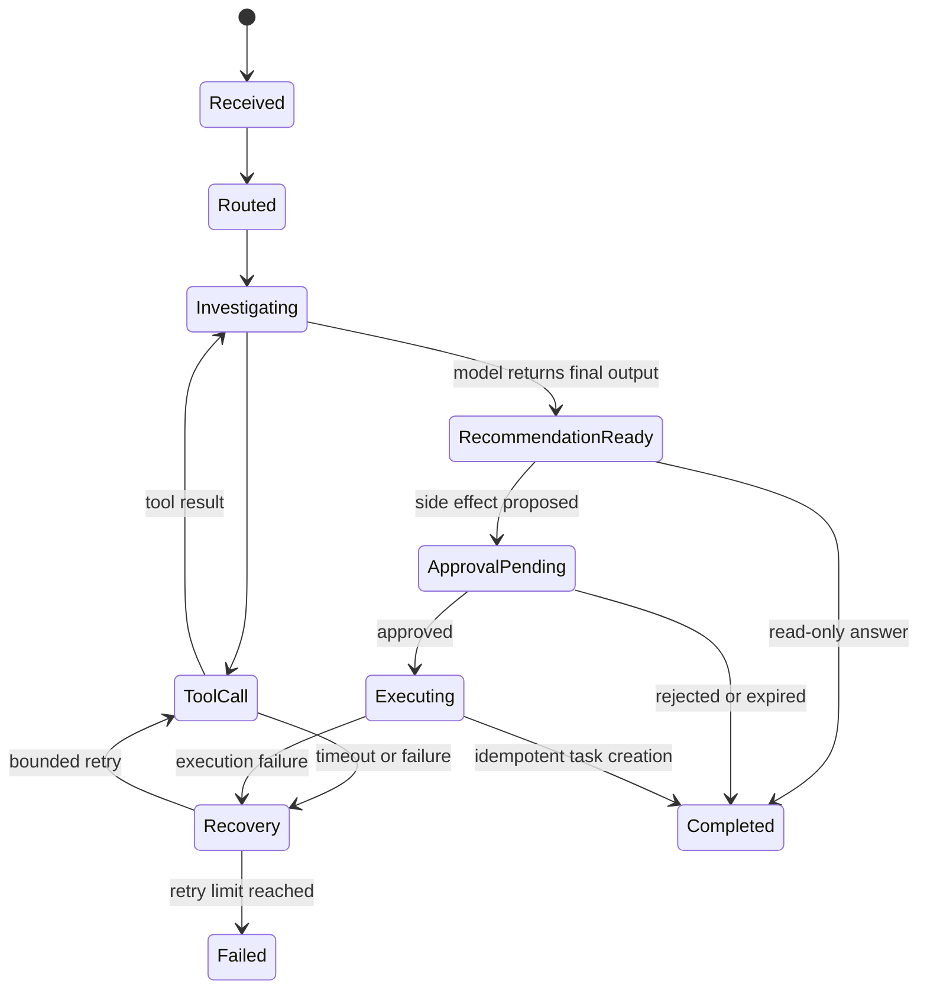

# Agent Workflow

Rules:

- Maximum tool calls are defined by the routing decision.
- Duplicate tool calls are detected before execution.
- Only the application, not the model, can authorize a side effect.
- Every terminal state is observable and persisted where appropriate.
