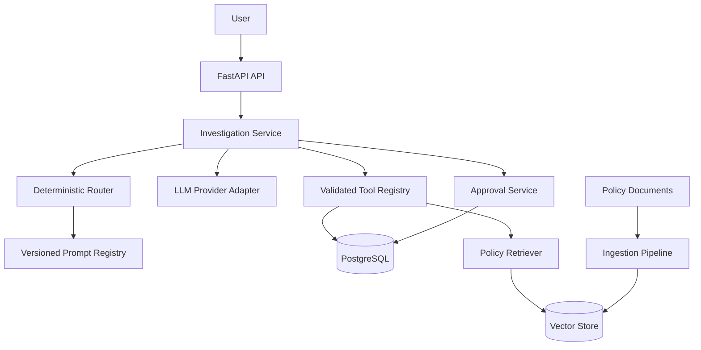

# System Architecture

Initial implementation uses one general reasoning model, one embedding model, deterministic routing, PostgreSQL, and a fake provider for tests. Redis, background workers, and multi-agent orchestration are deferred until the workflow baseline is measured.
